# ☕ Kopi dan Nyemil (UTS - Pengembangan Aplikasi Mobile)

Aplikasi Android pemesanan kopi dan camilan bertema kopi. Pengguna dapat mendaftar, masuk, memilih menu, memasukkannya ke keranjang, mengisi alamat pengiriman, lalu menerima konfirmasi pesanan. Aplikasi ini dibuat sebagai tugas implementasi wireframe.

## Author

- **Nama**: Diaz Adriansyah
- **NIM**: 1247050083

## Fitur

- **Splash / Welcome**: halaman pembuka dengan logo, tagline, dan tombol _Start now_.
- **Sign Up**: pilihan masuk ke Register atau Login.
- **Register**: pendaftaran (nama lengkap, username, password) dengan validasi, lalu langsung masuk ke Home.
- **Login**: autentikasi ke akun dummy dan akun yang baru didaftarkan. Akun demo: `demo` / `demo123`.
- **Home**: menu makanan dan minuman (8 item), filter kategori (Semua, Minuman, Makanan), dan **sistem keranjang** (tambah, kurangi, hapus, total harga real-time) lewat _bottom sheet_.
- **Profile**: ubah nama dan keluar akun.
- **Alamat Pengiriman (Order)**: form penerima, alamat, dan patokan beserta ringkasan pesanan dan total.
- **Konfirmasi Pesanan**: nomor pesanan, **daftar item yang dipesan**, total, dan alamat tujuan.
- Bottom navigation (Home, Order, Profile) dan tema warna kopi.

## Teknologi

- Kotlin
- XML layout + ViewBinding
- Material Components 3 (Material UI), RecyclerView, BottomSheetDialog, BottomNavigationView, Chip, TextInputLayout
- Data statis in-memory (tanpa database)
- Min SDK 27, Target SDK 37

## Struktur

```sh
uts/app/src/main/java/pam/pertemuan8/uts/
 ┣ adapter
 ┃ ┣ CartAdapter.kt
 ┃ ┣ OrderItemAdapter.kt
 ┃ ┗ ProductAdapter.kt
 ┣ data # model dan penyimpanan in-memory
 ┃ ┣ CartItem.kt
 ┃ ┣ CartManager.kt
 ┃ ┣ MenuRepository.kt
 ┃ ┣ Order.kt
 ┃ ┣ OrderManager.kt
 ┃ ┣ Product.kt
 ┃ ┣ User.kt
 ┃ ┗ UserSession.kt
 ┣ ui
 ┃ ┣ AddressActivity.kt
 ┃ ┣ ConfirmationActivity.kt
 ┃ ┣ HomeActivity.kt
 ┃ ┣ LoginActivity.kt
 ┃ ┣ ProfileActivity.kt
 ┃ ┣ RegisterActivity.kt
 ┃ ┣ SignUpActivity.kt
 ┃ ┗ SplashActivity.kt
 ┗ util # extension (format Rupiah, navigasi, keyboard)
   ┗ UiExt.kt
```

## Cara menjalankan

1. Clone repository:
   ```bash
   git clone https://github.com/Diaz-adrianz/pengembangan-aplikasi-mobile.git
   ```
2. Buka folder proyek `Pertemuan8/uts` di **Android Studio**.
3. Tunggu _Gradle Sync_ selesai.
4. Pilih emulator atau perangkat fisik (Android 7.0 ke atas), lalu klik **Run ▶**.

## Alur penggunaan

Splash → Sign up → Register/Login → Home → tambah menu ke keranjang → _Lihat keranjang_ → _Pesan sekarang_ → isi Alamat → _Order dan Kirim_ → Konfirmasi → _Oke_ → Home.

## Screenshot

| Splash                         | Sign up                        | Register                         | Home (minuman)                      |
| ------------------------------ | ------------------------------ | -------------------------------- | ----------------------------------- |
| 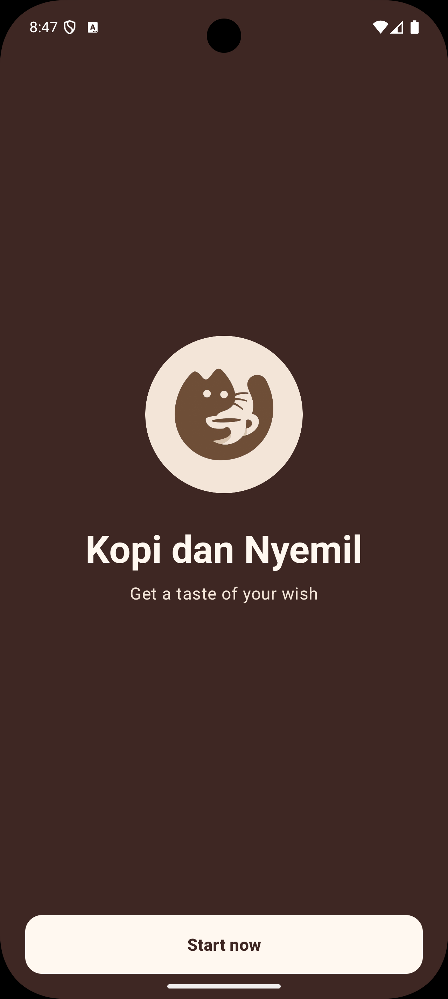 | 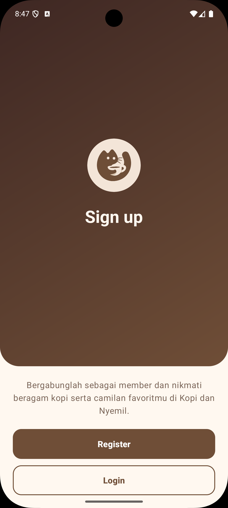 | 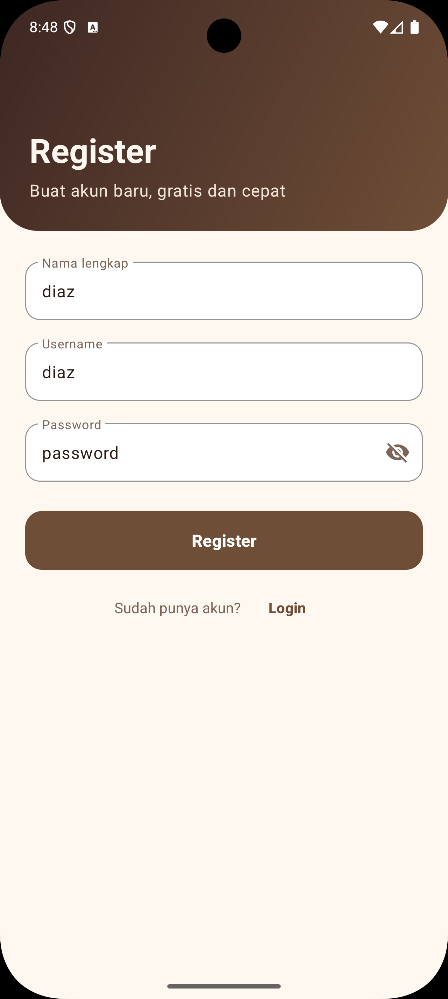 | 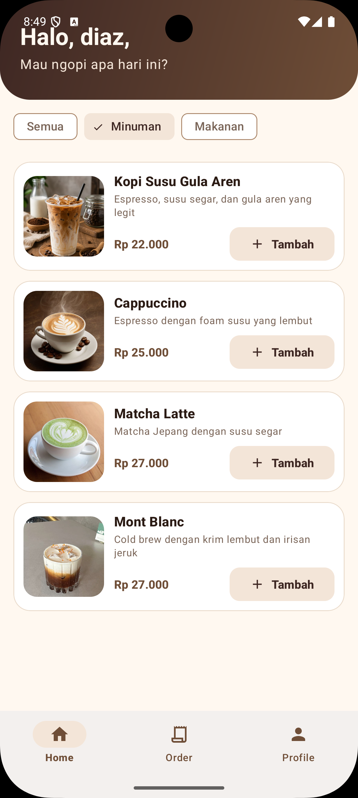 |

| Home (makanan)                     | Home                         | Home + keranjang                       | Alamat                          |
| ---------------------------------- | ---------------------------- | -------------------------------------- | ------------------------------- |
| 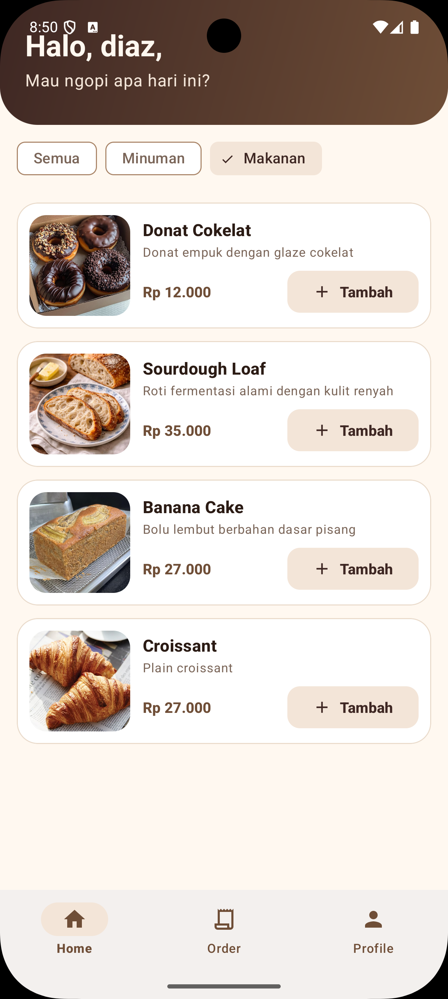 | 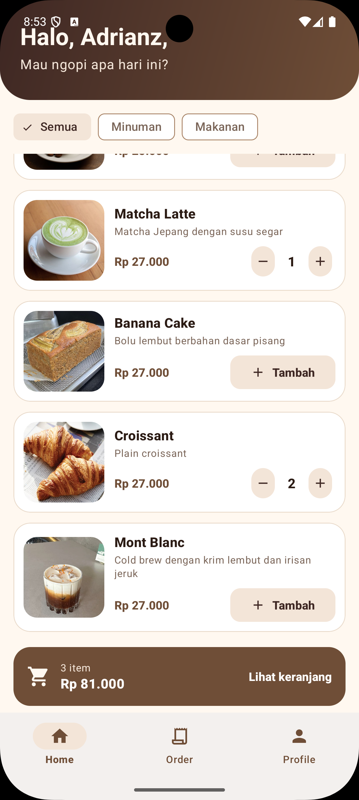 | 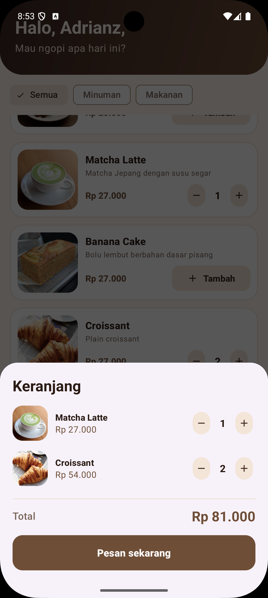 | 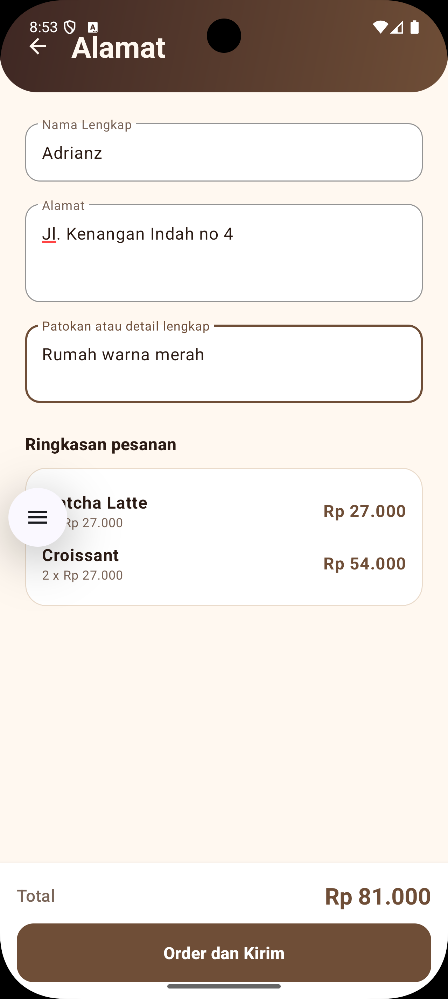 |

| Konfirmasi                           | Profil                          | Login                         |
| ------------------------------------ | ------------------------------- | ----------------------------- |
| 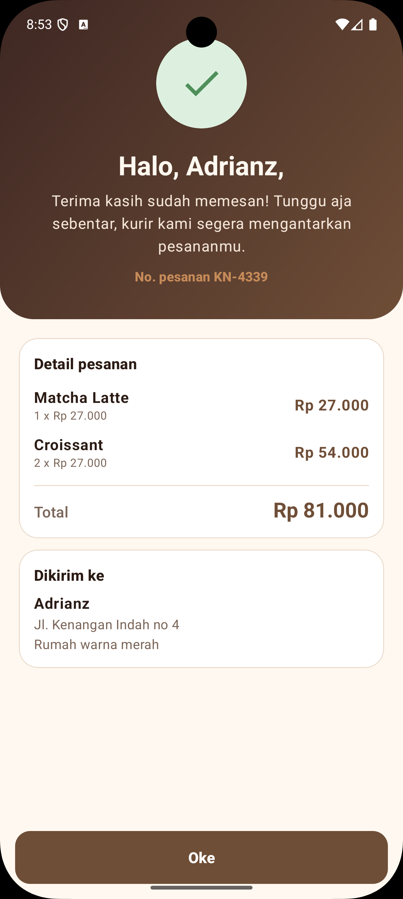 | 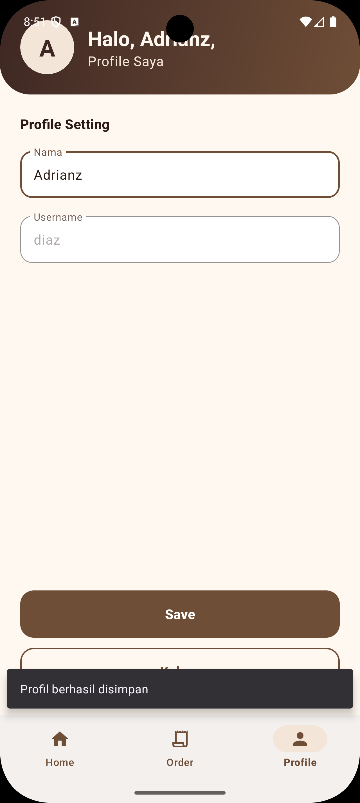 | 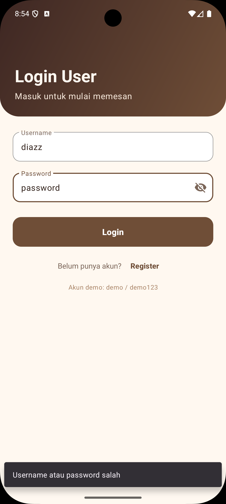 |

## Catatan

Data hanya disimpan di memori, jadi akun yang didaftarkan dan keranjang akan hilang saat aplikasi ditutup penuh.

